# FoodRecommendation
美食推荐系统 
亮点：协同过滤算法推荐、AI助手、HanLP中文分词、 ECharts可视化分析、菜谱学习与话题交流；
角色:管理员、用户；

所有源码均本人开发，项目是前后端分离的，所有的项目都具备了完整的业务逻辑，不仅仅局限于基础的增删改查（CRUD）操作，系统亮点众多。

本文注重于计算机毕业设计选题指导，列出题目均有源码， 大家可以去【公众号】(毕业终点站)获取或者加我【qq】(2112698948)提意见(别忘记Star哟)。备注：git

声明：仅用于学习使用，请勿用于任何商业行为！

1.系统非商用，非开源，非无偿。

2.由本人开发，如需源码，请联系以下方式，qq:2112698948。

3.项目有很多，并未全部上传，如果未找到想要的，可直接咨询。

# 寻味 · 美食推荐系统

> Vue 2.6 + Spring Boot 3 前后端分离，Web 前台加管理后台：用户看菜谱、学做菜、发话题、聊 AI，管理员管用户、菜谱、材料、步骤和四类统计。推荐部分做了三套算法——内容相似、浏览偏好、话题协同过滤。

做这套系统起因挺实在——市面上的"美食博客"demo 大多只有列表和详情两页，推荐那栏写个"猜你喜欢"，点进去是随机抽的。可真要答辩，老师第一句就问"你怎么推荐"。所以这套把推荐拆成三条能讲清楚的路径：一道菜的相似菜谱靠加权特征向量算余弦；首页的"为您推荐"看你最近 100 条浏览记录，归一化之后用 Smile 算欧氏距离；美食广场的"推荐"则是拿话题浏览记录算用户之间的余弦相似度，把别人看过的话题推给你。三条路各管一段，不是同一个函数换个参数。

## 技术栈

| 层次 | 技术选型 |
| --- | --- |
| 架构 | B/S、MVC、前后端分离、Web 用户前台 + 管理后台、管理员与普通用户角色区分 |
| 服务端 | Java 17、Spring Boot 3.3.1、Spring MVC、MyBatis-Plus、MySQL、JWT、Apache POI、Smile、HanLP |
| 前端 | Vue 2.6、Vue CLI、Element UI、Vue Router、Vuex、Axios、ECharts、echarts-wordcloud、AiEditor |
| 开发环境 | Windows、IDEA、Maven、Node.js |

## 推荐是怎么算的

**1. 菜谱内容相似推荐（余弦相似度）**
给每道菜构建加权特征向量，特征来自标题、正文、标签、烹饪技巧和分类五个来源，再算菜谱之间的余弦相似度，取分值靠前的作为"相似菜谱"。所以点开一道草莓奶油蛋糕，下面推的是同一类烘焙甜点，而不是碰巧同名的菜。

**2. 浏览偏好推荐（Smile 欧氏距离）**
取用户最近 100 条浏览记录，把记录里的分类、标签、技巧三个维度汇总成偏好分布并归一化，再用 Smile 的欧氏距离衡量候选菜谱和这份偏好差多远，距离近的排前面。没有浏览记录、或者算出来候选为空时，退回随机菜谱推荐——新用户首页不会空白。

**3. 话题协同过滤（用户余弦相似度）**
按话题浏览记录构建用户行为向量，算用户两两之间的余弦相似度，找出和你口味接近的人，再把这些人浏览过、而你还没看过的话题汇成候选。这是美食广场"推荐"页签的排序依据。

**4. 相似话题推荐（余弦相似度）**
话题详情页下面那一栏，是把当前话题的标题和正文提成特征，和已审核通过的话题算余弦相似度，取相近的展示。只从审核通过的里面挑，未过审的内容不会被推荐出去。

## 功能亮点

**1. 讯飞星火 AI 助手**
通过 WebSocket 接入星火大模型，提问后回复按流式吐字，不是等一整个答案生成完再显示。另外话题编辑用的是 AiEditor 富文本编辑器，写分享时可以叫 AI 帮忙顺一遍文案。

**2. HanLP 中文分词 + 词云**
对菜谱标题做分词和词频统计，用 echarts-wordcloud 画成词云。管理员不用一条条翻菜谱，看词云就知道平台上"蛋糕""鸡""汤"这些词出现了多少次、内容偏哪一类。

**3. ECharts 四套分析视图**
用户画像统计、话题统计、话题综合分析、菜谱综合分析四个页面分开做，不是把图堆在一个大屏里。菜谱综合分析又细分了类型分布、步骤数量分布和热门标签词云。

**4. 菜谱的三段结构**
一道菜拆成菜谱信息、菜谱材料、菜谱步骤三张表：信息表存标题、封面、类型、技巧、标签；材料表存食材名和用量（如牛奶 50g、鸡蛋 5 个）；步骤表按序号存文字和配图。前台详情页的"食材清单""制作步骤"两个页签就是从这两张表读的。

**5. 话题从写到发有审核**
用户发的话题先落"审核中"，管理员在话题信息页点通过或者不通过，通过之后才会出现在美食广场；管理员还能给通过的标"推荐"，前台就会带推荐位。用户自己的手记页能看到每条话题的审核状态。

## 系统角色与界面

### 登录入口

账号、密码之外有一个"登录身份"开关，在管理员和用户之间切换，下面还有图形验证码，底部是注册入口。

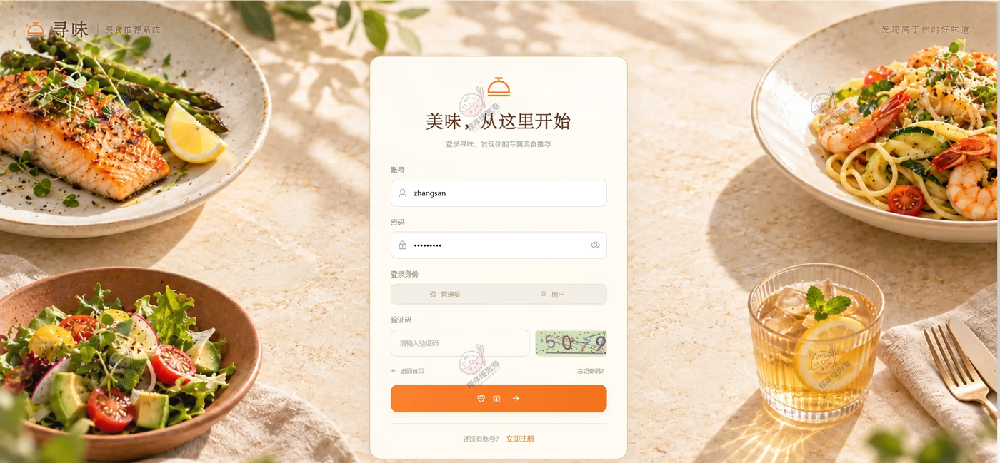

### 一、用户端（Web 前台）

顶部导航六项：首页、菜谱发现、美食交流、我的收藏、我的话题、关于我们，右侧一个全站搜索框和用户菜单。

**首页**
整屏米色调，banner 是"寻味生活 / 发现你的心动美食"，下面五个分类入口——烘焙大全（面包、蛋糕、甜品）、各地小吃（陕西、广东、四川）、外国食谱（意式、日式、韩式）、中国菜系、常见菜式（家常菜、早餐、汤粥）。再往下是"为您推荐"，带"换一批"按钮和全部、家常菜、早餐、烘焙、地方风味、异国料理六个筛选项，每张卡片左上角标精选或 NEW，右下角是浏览数，右上角可以直接收藏。这一块就是按浏览偏好算出来的排序。

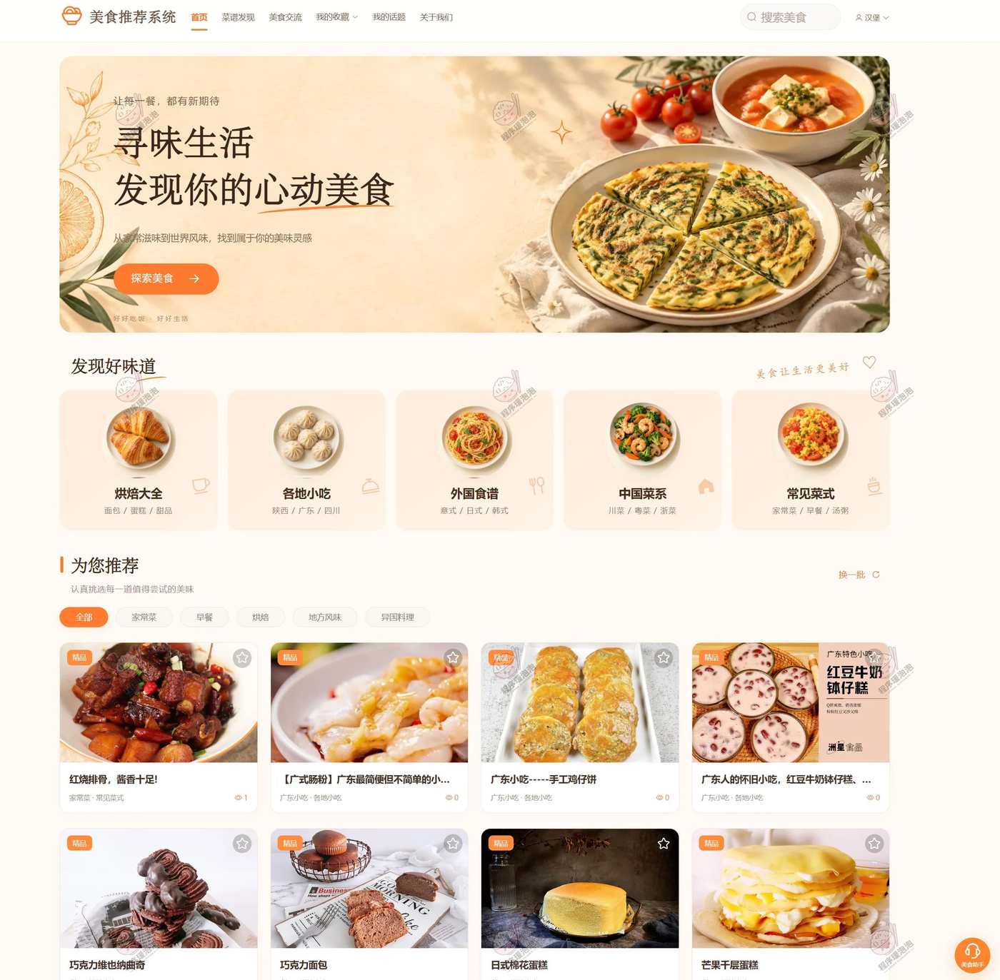

**菜谱发现**
大标题一句"今天，想吃点什么？"，搜索框提示"搜索菜名、食材或你喜欢的味道"——说明检索是同时匹配菜名和食材的。下面是全部菜谱的瀑布式卡片，每张给出标签（烘焙、精品、甜点）、浏览次数和"去做这道美食"的入口。

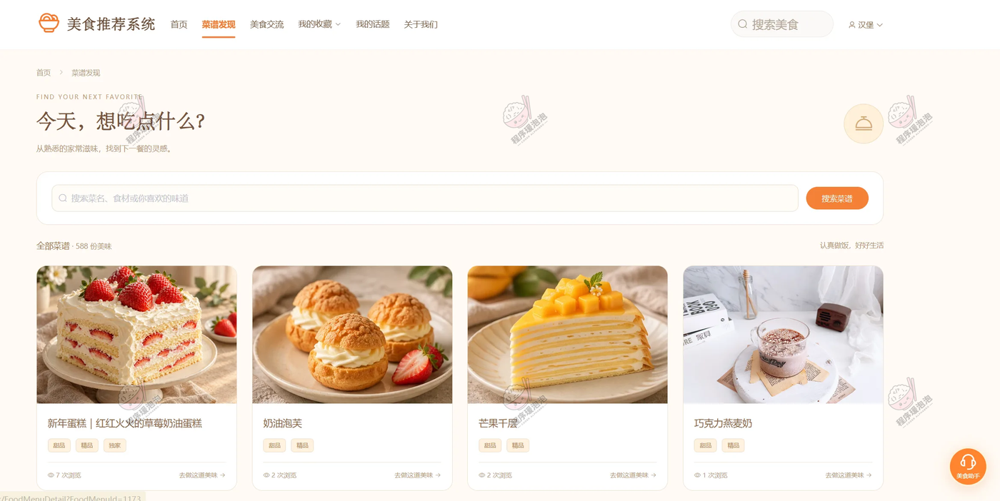

**菜谱详情**
左边大图配四张缩略图，右边是一串关键信息：面包屑式的分类（烘焙大全 / 甜品）、标签、标题、一段简介，然后四个数字并排——10 种食材、7 个步骤、7 次浏览、2 人收藏。这两个数字不是写死的，后台材料表里这道菜的牛奶 50g、鸡蛋 5 个等配料条目数，和步骤表里排到第 7 步，正好对上。下方四个页签是菜谱简介、食材清单、制作步骤、烹饪贴士，收藏和分享按钮在中间。

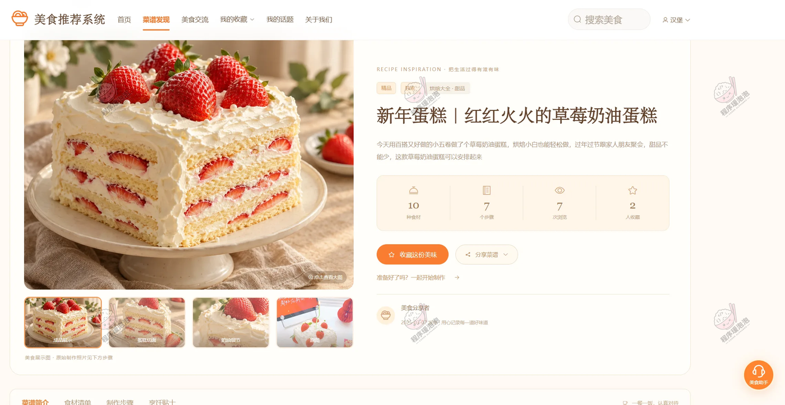

**美食交流（美食广场）**
上面是"把美味，分享给懂的人"的横幅，下面"美食广场"计 13 篇分享，四个排序页签：推荐、近期、热门、优选，再下面一排是话题分类（墨西哥街头小吃、法式大餐体验、意大利面食全知道、泰国风味挑战等）。右侧"热门讨论"榜给到浏览数和评论数——提拉米苏 94 次浏览 1 条讨论、鲈鱼炒野菜 56 次、Pozole 鸡肉玉米红白汤 54 次、榴莲糯米饭 44 次、鱼香鸡丁 43 次。列表里的每篇分享都带作者、发布时间、浏览和评论数，"推荐"这个页签后面接的就是话题协同过滤。

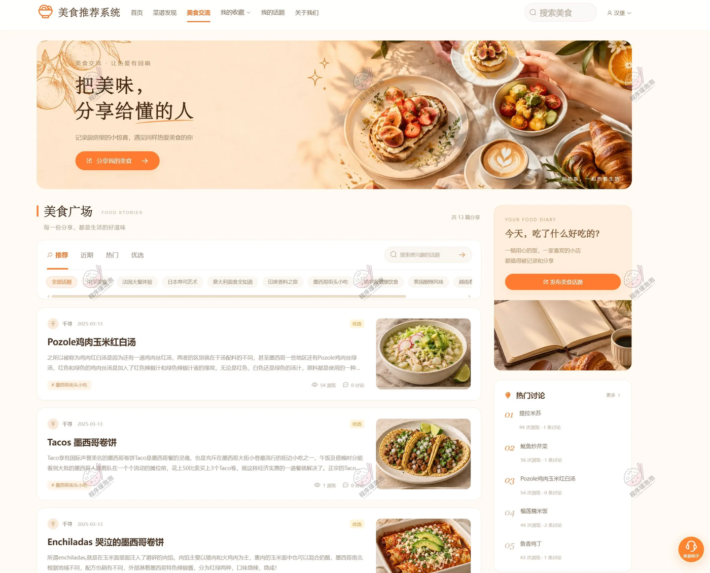

**话题详情**
顶部是杂志式排版：左侧标题配标签（墨西哥街头小吃、社区优选），右侧大图。往下是"THE STORY 关于这份美味"的正文，作者可以附带浏览图。再下面是收藏、聊聊、分享三个动作，右侧一张作者卡片（千寻，"用美食，记住生活的温度"）带关注入口。最底是评论区"让美味，有来有往"，统计讨论条数。

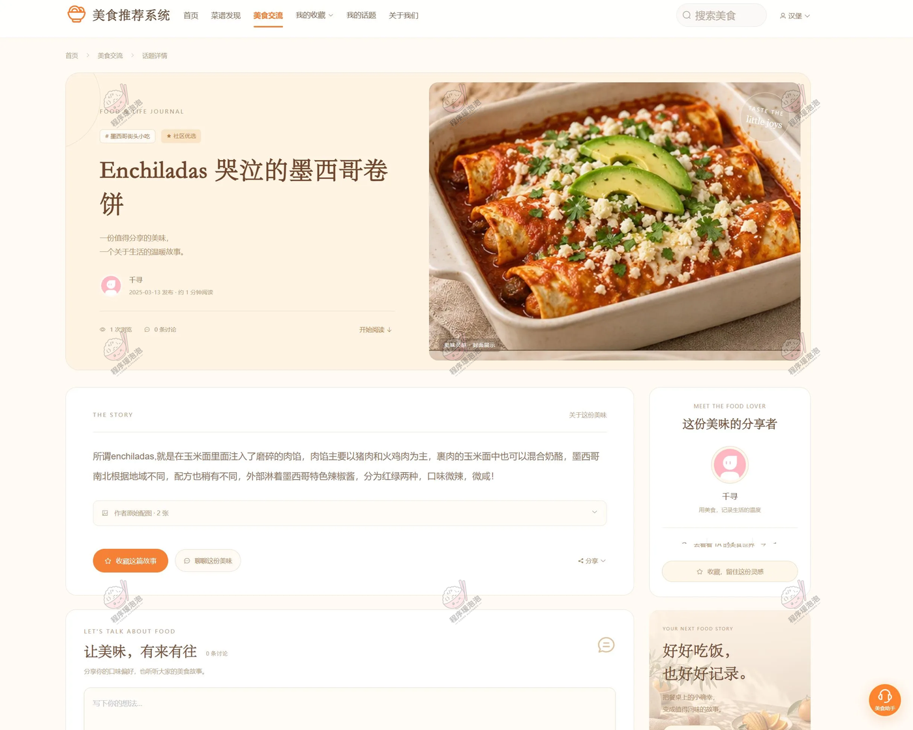

**我的收藏（收藏菜谱）**
"我的收藏夹"计 2 道心动美味，页签分全部收藏 2、常见菜式 2，支持按菜谱名搜索、按最近收藏排序。每张卡右下角标着收藏时间（2026-10-18）和"已收藏"状态。页面底部还有一条"再发现一些好味道"，横向推荐四道菜——这是收藏页也留了推荐位。

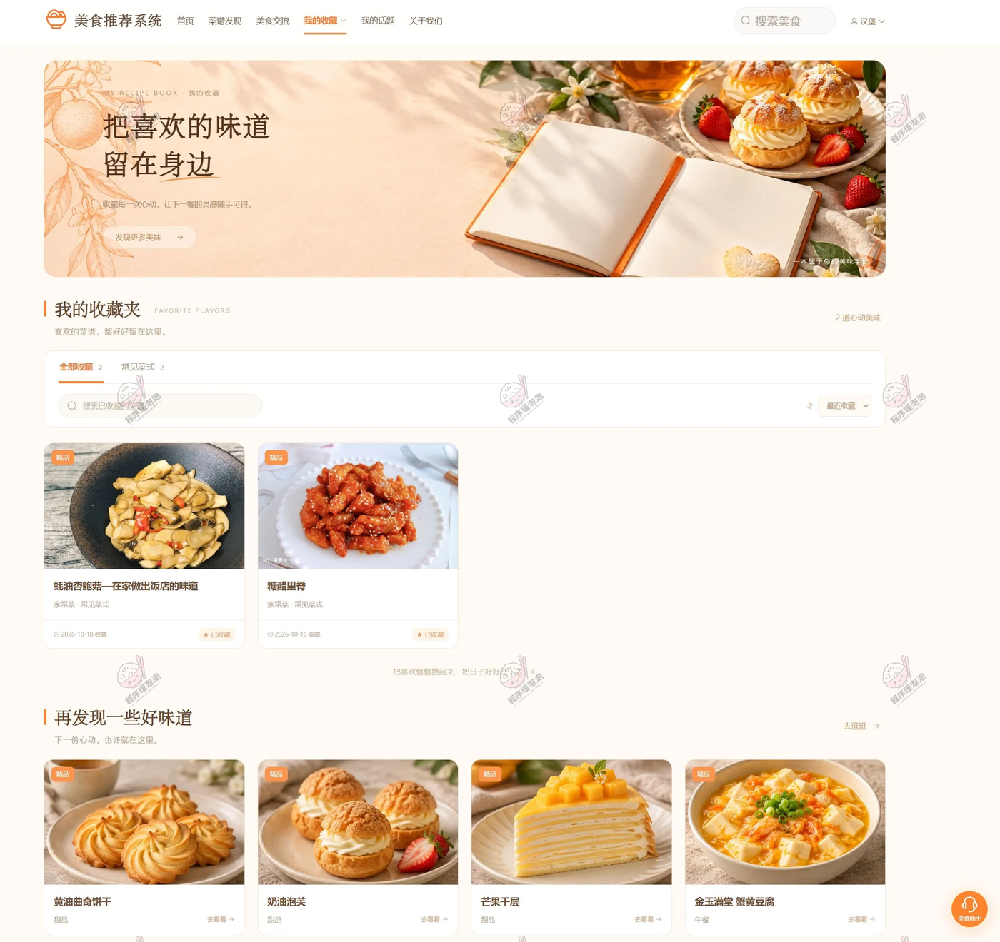

**我的话题收藏**
"我的收藏"这一栏其实是三个页签共用的：收藏菜谱、收藏话题、我的话题，切过来就是话题收藏夹，计 1 篇。列表给话题标题、分类、收藏时间、浏览数和"查看话题 / 取消收藏"两个动作。

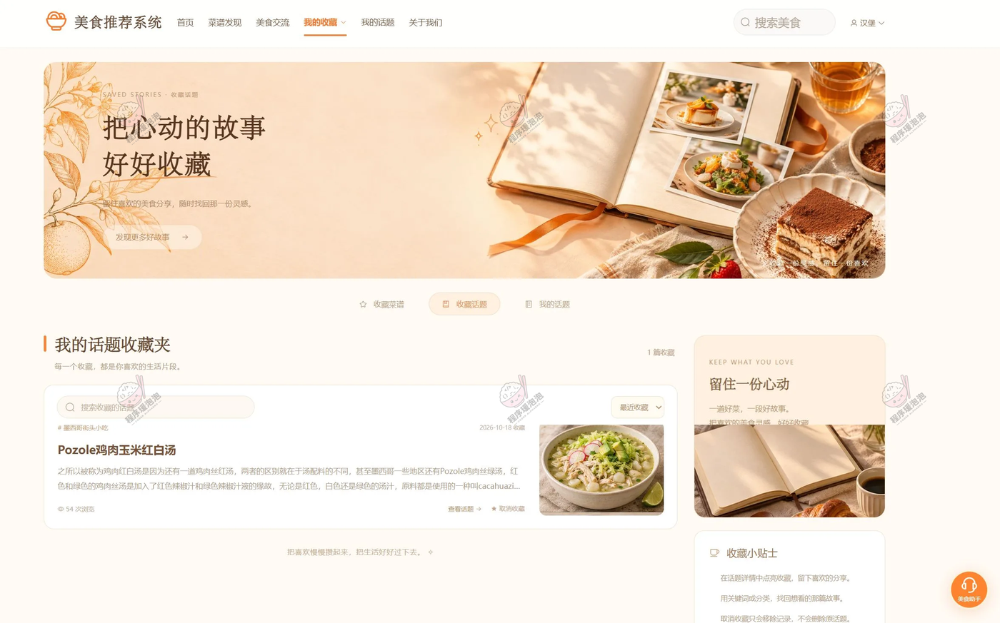

**我的美食手记（我的话题）**
自己发过的分享都在这里，计 1 篇，卡片右上角是审核状态——截图这条标"审核通过"，下面"查看详情 / 编辑 / 删除"三个动作。右侧贴士里写明"新话题需审核通过后才会在广场展示"，把审核这条规则直接告诉了用户，省得发完找不到。

**关于我们**
三段式静态页：我们的初心、我们的用心、开启美味之旅，讲的是项目定位和内容主张，用来收尾比较合适。

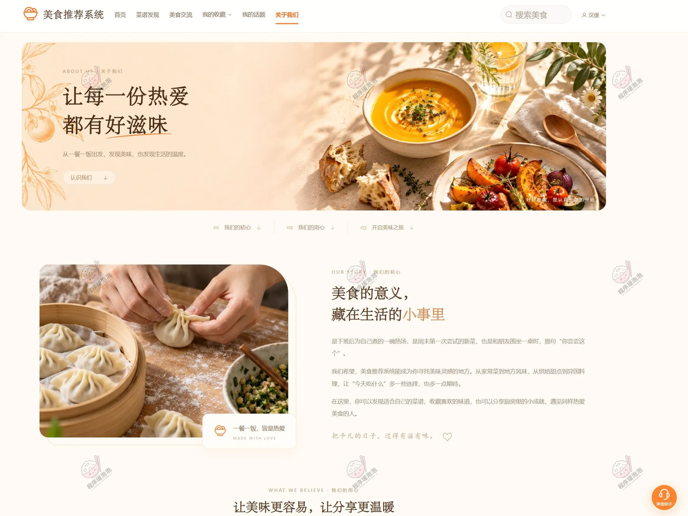

### 二、管理员端（Web 后台）

左侧菜单五组：工作台（控制台）、用户管理（用户信息、用户画像统计）、话题管理（话题信息、话题类型、话题统计、话题综合分析）、菜谱管理（菜谱信息、菜谱类型、菜谱材料、菜谱步骤、菜谱综合分析）、用户行为（菜谱收藏、菜谱浏览记录）。

**用户画像统计**
四张卡片：总用户数 11（较上月涨 15.7%）、高活跃用户 2（占总用户 18.2%）、总互动数 330（平均每人 30.0 次）、今日新增 9（日环比 3.4%）。下面两张图是用户年龄分布（18 岁以下 60%、18-24 岁 40%）和用户活跃度分布（高度活跃 18.18%、活跃 45.45%、中等活跃 36.36%）。这两个数能对上——2 除以 11 正好是 18.18%，卡片上的"占 18.2%"和饼图里那一块是同一个口径；330 除以 11 也正好是 30.0，"平均每人 30 次"是算出来的不是填的。

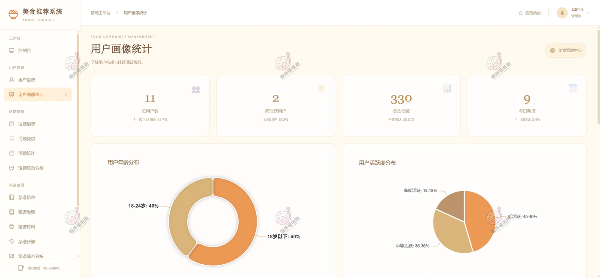

**话题信息**
按标题和话题类型筛，列表十列：标题、话题类型、封面、主题、浏览次数、内容、是否推荐、审核状态、创建人、操作。审核通过与否单独一列，"是否推荐"又是一列，操作列同时给"推荐 / 取消推荐"和"删除"。换句话说推荐位和审核状态是两件事，通过了不一定上推荐，推荐了也还能撤回来。

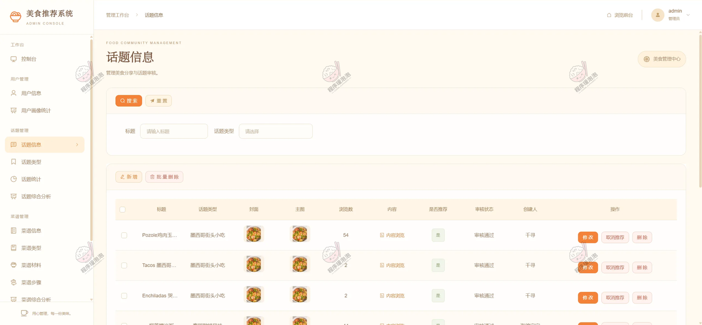

**菜谱信息**
维护菜谱内容、封面与烹饪技巧。筛选项是标题、技巧、标签、菜谱类型、内容五个，列表把技巧和标签都摊出来，比如"要做好吃都有技巧，我的……"配"精品独家"标签。技巧单独存一列，是因为前台详情页的"烹饪贴士"页签直接读它。

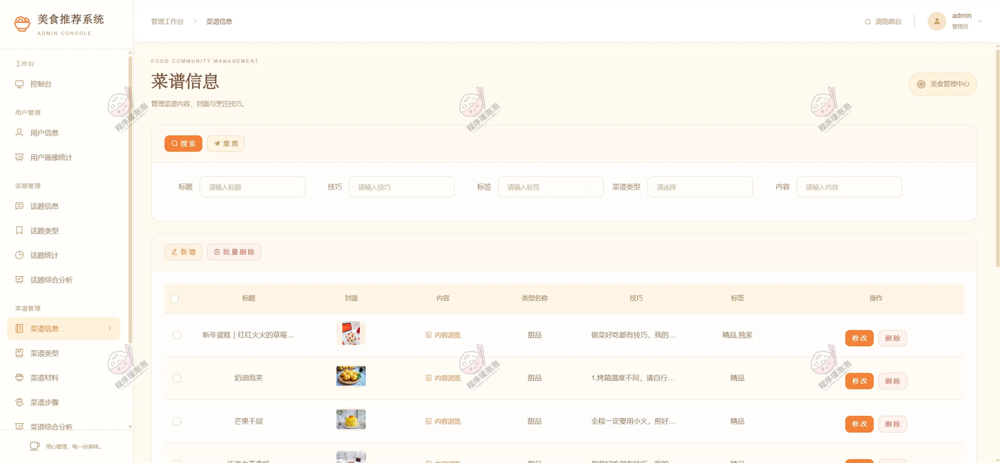

**菜谱材料**
管理食材及用量，一条记录就是"材料名称 + 用量 + 所属菜谱"。新年蛋糕那道菜的配料在这儿能看到：牛奶 50g、细砂糖、糖珠、鸡蛋 5 个。这道菜在前台详情页显示"10 种食材"，数量就是这张表里挂在这道菜名下的条目数。

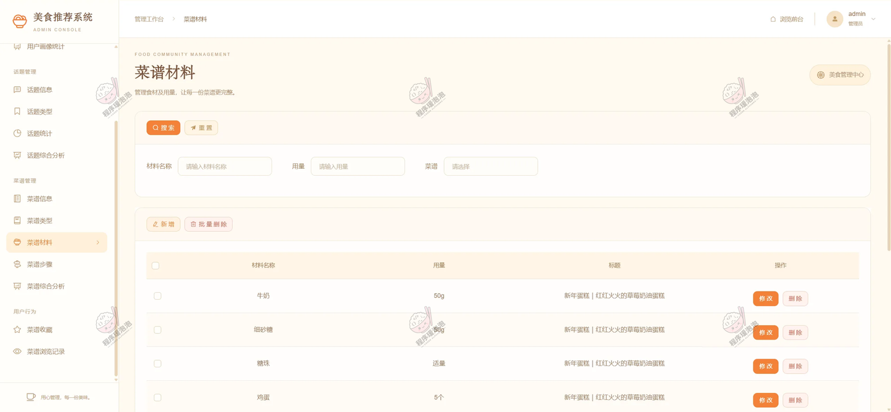

**菜谱步骤**
按序号存每一步的文字和配图。同是新年蛋糕，能看到第 1 步"牛奶+玉米油搅拌至乳化状态，倒入低筋……"、第 5 步"出炉震两下烤盘即可"、第 7 步"好看又好吃，做法巨简单"，步骤号连续到 7，对应前台的"7 个步骤"。

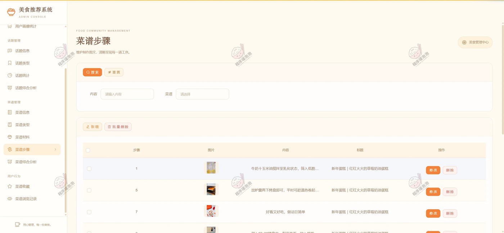

**菜谱综合分析**
四张卡片：菜谱总数 588、总浏览量 499、总收藏量 17，第四张是收藏相关的比值。下面两张图是菜谱类型分布（环形图，图例里能看到热菜、烘焙、面包、糕点、早餐、主食、意大利面等十几个类型）和步骤数量分布（1-3 步 2 道占 0.34%、4-6 步 100 道占 17.01%、7-10 步 229 道占 38.94%、11 步以上 257 道占 43.71%）。这四块加起来 2 + 100 + 229 + 257 = 588，和卡片上的菜谱总数完全一致，也说明占比是按同一个分母算的。最下面是热门标签词云，就是 HanLP 分词词频的落点。

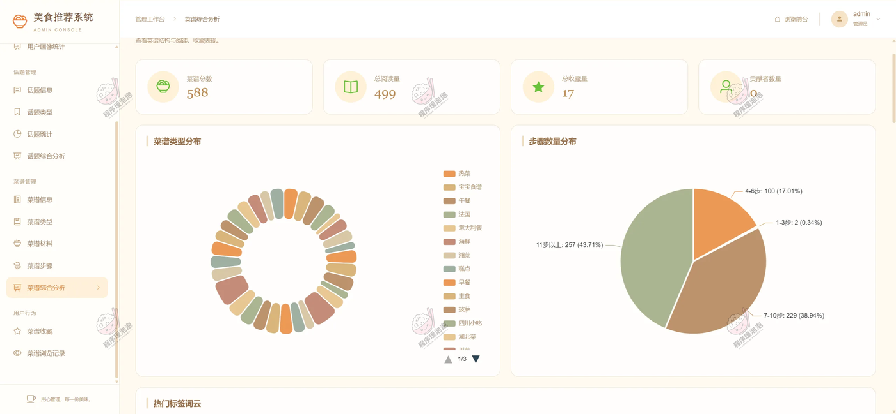

## 说明

- 文档展示 16 张截图，需要了解更多，请联系我。
- 截图中的用户、菜谱、话题、浏览与收藏数据均为演示数据，演示账号 `zhangsen` / `admin` 为初始账号。
